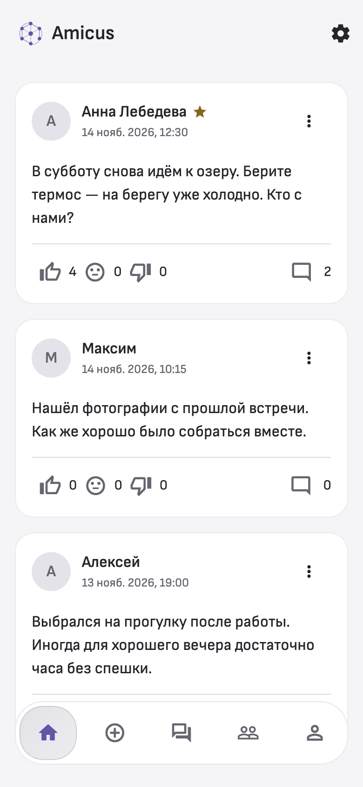
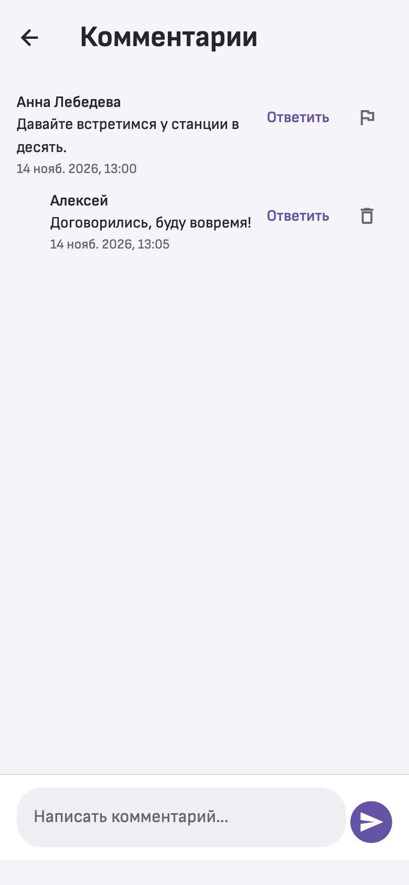
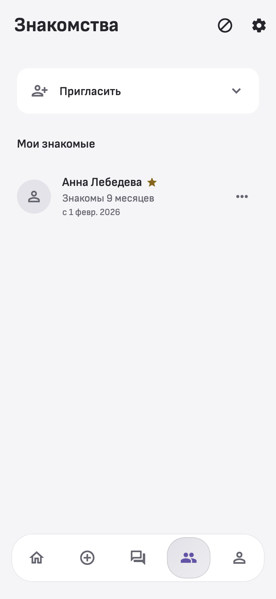
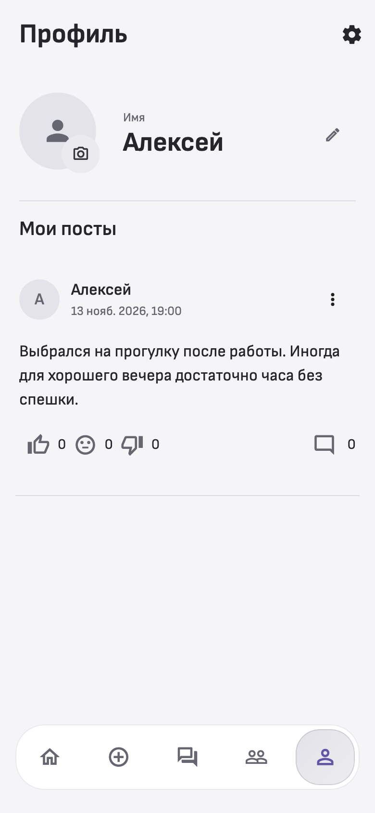

# Amicus

> A feed-style social network where you only see posts from people you've genuinely met — in person or through an invite from a friend.

The idea behind the app is not just privacy but also a **digital detox**: the feed is not infinite and not driven by an algorithm. You only see content from your Connections, with no random recommendations and no pressure of endless scrolling. At the same time you don't lose touch with your friends — the content is still there, just within a narrow circle of people you know.

A pilot/portfolio project (originally developed under the working name "Круг", "Circle"). The original idea and mechanics are in [docs/project-brief.md](docs/project-brief.md); the current data model is in [docs/data-model.md](docs/data-model.md) (the brief holds its first draft, not what it turned into).

## Status

The app version in this checkout is **0.19.3 (build 80)**. Android builds go to
Google Play closed testing (`alpha`), and iOS builds go through TestFlight separately.
Check delivery and availability for each channel in the
[release runbook](docs/operations.md#release).

## Features

- Sign-in/sign-up and a shared layout for your profile and your Connections' profiles, with a photo gallery (up to 80) and a wall of post cards
- Manage your gallery from the camera button on your avatar and edit your name from the profile toolbar
- Connections via an invite link — open profiles from post author blocks or full Connection rows
- Local post drafts restore text, audience and ordered attachments after leaving or restarting; successful publication clears the draft
- Feed: text and up to 20 photos/videos per post, reactions, comments with replies (one level of nesting)
- Post visibility: publish to all Connections or only your favorites; editing can change that audience
- Rooms: realtime chats with unread counts, delivery/read receipts, presence,
  typing and push notifications; up to 10 photos/videos per message, quoted
  replies, editing your messages within 48 hours, and per-room notification
  muting. Reconnecting recovers missed messages and refreshes edits and
  moderation changes. Open a member's profile from a message or a direct-chat header.
- A two-person room is named after the other person and appears for both; for a group of three or more, the owner sets a name and an avatar, and adds and removes people
- Connection request — to a member of a shared room if you aren't connected yet: the only way to connect without meeting in person, and it's available only where people already share a chat
- Mute, block and favorites — with push notifications and fine-grained per-source settings
- Report a post, a comment, a room message or the person themselves: the author never learns who reported, and reports are reviewed from the local console — hide, delete, impose a write ban or lock the account
- Light, dark and system themes, two locales (en/ru), and floating/classic navigation, all selectable in Settings
- Sign-out and account deletion, both with confirmation

Full feature history is in [CHANGELOG.md](CHANGELOG.md).

## Screenshots

Interface previews for 0.19.2, using fictional people and content.

<table>
<tr>
<td><br><sub>Feed</sub></td>
<td><br><sub>Comments</sub></td>
<td><br><sub>Connections</sub></td>
<td><br><sub>Profile</sub></td>
</tr>
</table>

## Stack

- **Frontend:** Flutter / Dart (Android and iOS, see [docs/ios-deployment-guide.md](docs/ios-deployment-guide.md))
- **Backend:** [Supabase](https://supabase.com) — PostgreSQL, Auth, Storage, Realtime, Row Level Security
- **State management:** Riverpod
- **Navigation:** go_router
- **CI:** GitHub Actions — `dart format`, `flutter analyze`, `flutter test` and an `.aab` build on every push/PR (plus a version-bump check on PRs); a push to `main` builds a signed bundle and uploads it to Play (see [docs/operations.md](docs/operations.md))

Data access is enforced by database grants, RLS and server functions. Feed
visibility includes the author, eligible Connections and the system account,
then applies each post's audience and moderation rules. Blocking hides posts
and comments in both directions; mute filters only the main feed on this
client and leaves the person's profile accessible. Profile rows also have
limited room-peer and visible-commenter audiences; a room peer can read the
current avatar, without access to the photo gallery. Reaction counts expose
aggregates and your own selection. See [the visibility rule](docs/data-model.md#visibility-rule)
for the complete boundaries rather than treating a client screen as security.

Room chat is locked down the same way: a message is visible to whoever is in the room, and the subscription to new messages is no exception. Postgres Changes checks the same SELECT policy for each subscriber, so other people's conversations don't arrive over the realtime channel either.

## Repository layout

```
app/                     — Flutter app
  lib/features/          — auth, connections, feed, notifications, profile, rooms, settings, shell
  lib/shared/            — code used by several features at once
  test/                  — unit and widget tests
supabase/migrations/     — DB schema and RLS policies (baseline + migrations on top)
supabase/functions/      — send-push Edge Function (notification delivery via FCM;
                           push texts live there too)
console/                 — local admin console (React + Vite): database slices,
                           report review, news-account posts, broadcasts.
                           Lives only on the developer's machine, never
                           deployed — see console/README.md
docs/                    — DB schema, client architecture, operations,
                           deferred work and historical plans
docs/review/             — draft store texts awaiting proofreading
docs/gh-pages/           — sources of the GitHub Pages pages (privacy policy,
                           terms of use, email confirmation, password reset);
                           deployed by CI on push to main
```

## Running locally

```bash
cd app
flutter pub get
flutter run --dart-define-from-file=.env
```

Use [`app/.env.example`](app/.env.example) to configure a Supabase project.
Restore the Firebase configuration for the target platform before building.
See the [client setup](app/README.md).

## Documentation

Start with the [documentation index](docs/README.md) for current references,
release status and the distinction between current behavior and history.

Current:

- [Schema and visibility rule](docs/data-model.md) — tables, RLS, storage policies; the main document if you're figuring out how things work
- [Interface design](docs/interface-design.md) — visual tokens, layout and interaction principles
- [Client architecture](docs/client-architecture.md) — what the app is built with and what the client itself does on top of the schema
- [Performance](docs/performance.md) — image memory, foreground work, stable media state and verification limits
- [Operations](docs/operations.md) — scheduled jobs, secrets, release, Edge Function deployment, update-notification broadcast
- [Console](console/README.md) — the responsive local admin console for activity, users, moderation, news and broadcasts
- [iOS deployment](docs/ios-deployment-guide.md) — the path from simulator to TestFlight: Xcode, icons, export compliance, IPA build
- [iOS push notifications (APNs)](docs/ios-push-apns-setup.md) — APNs key, linking to Firebase Cloud Messaging
- [Xcode Cloud](docs/xcode-cloud-setup.md) and [API automation](docs/app-store-connect-api-automation.md) — remote stable iOS builds and authenticated build triggers
- [Deferred features](docs/future-development.md) — GPS tracks, web version, open questions
- [App Store listing draft](docs/review/app-store-listing-draft.md) — working copy for proofreading; actual submission status lives in App Store Connect
- [GitHub Pages pages](docs/gh-pages/) — the published privacy policy and terms of use, the email confirmation and password reset pages
- [Changelog](CHANGELOG.md#0193) — version history and the 0.19.3 changes

Historical — how the project was conceived and how it went, not how it works now:

- [Project brief](docs/project-brief.md) — the original idea and MVP scope
- [Implementation plan](docs/implementation-plan.md) — how the MVP went, stage by stage
- [Deferred-features archive](docs/future-development.archive.md) — the list of deferred features as of the MVP's completion
