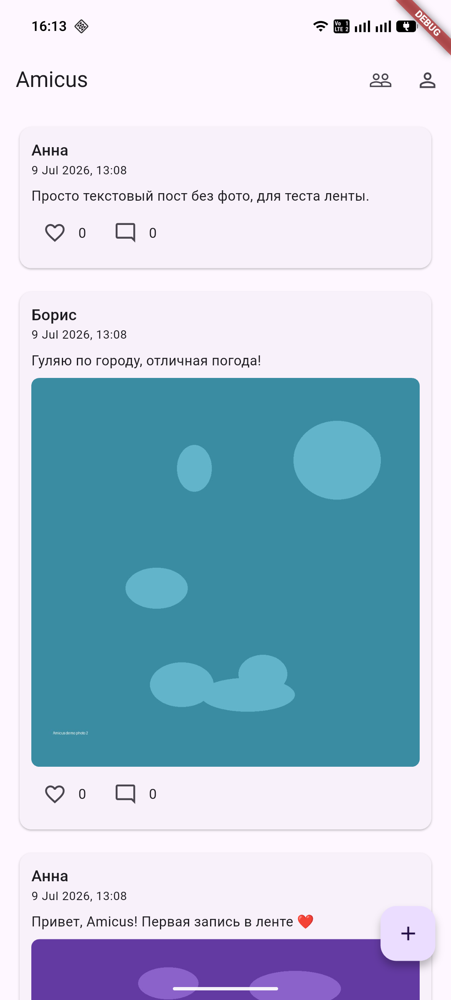
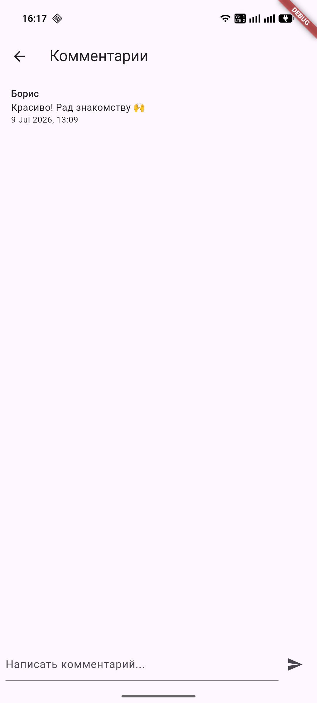
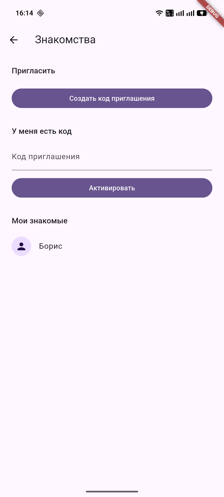
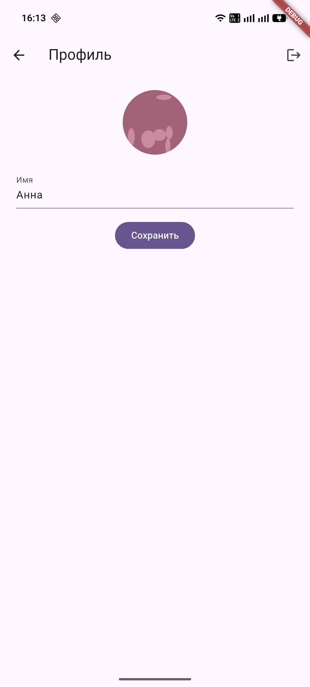

# Amicus

> A feed-style social network where you only see posts from people you've genuinely met — in person or through an invite from a friend.

The idea behind the app is not just privacy but also a **digital detox**: the feed is not infinite and not driven by an algorithm. You only see content from your Connections, with no random recommendations and no pressure of endless scrolling. At the same time you don't lose touch with your friends — the content is still there, just within a narrow circle of people you know.

A pilot/portfolio project (originally developed under the working name "Круг", "Circle"). The original idea and mechanics are in [docs/project-brief.md](docs/project-brief.md); the current data model is in [docs/data-model.md](docs/data-model.md) (the brief holds its first draft, not what it turned into).

## Status

Deployed on Android (Google Play, Closed testing — the `alpha` track) and on iOS
(TestFlight). Currently — testing and fine-tuning features on both platforms (see
[docs/future-development.md](docs/future-development.md)).

## Features

- Sign-in/sign-up, a profile with a photo gallery (up to 80) and your own wall of posts
- Connections via an invite link — with access to the connection's profile and posts
- Feed: text and up to 20 photos/videos per post, reactions, comments with replies (one level of nesting)
- Post visibility: when publishing (and later, when editing) you can choose who sees it — all connections or only selected ones
- Rooms: a separate chat for the people you invited — messages arrive via a realtime subscription, with unread counts, "Delivered"/"Read" ticks, "online"/"typing…" statuses and pushes; a message can carry up to 10 photos/videos, you can reply to a specific message with a quote, and mute the chat itself separately from everything else; the list is split by day ("Today", "Yesterday", a date)
- A two-person room is named after the other person and appears for both; for a group of three or more, the owner sets a name and an avatar, and adds and removes people
- Connection request — to a member of a shared room if you aren't connected yet: the only way to connect without meeting in person, and it's available only where people already share a chat
- Mute, block and favorites — with push notifications and fine-grained per-source settings
- Report a post, a comment, a room message or the person themselves: the author never learns who reported, and reports are reviewed from the local console — hide, delete, impose a write ban or lock the account
- Dark theme, two locales (en/ru) with a language switcher
- Sign-out and account deletion, both with confirmation

Full feature history is in [CHANGELOG.md](CHANGELOG.md).

## Screenshots

<table>
<tr>
<td><br><sub>Feed</sub></td>
<td><br><sub>Comments</sub></td>
<td><br><sub>Connections</sub></td>
<td><br><sub>Profile</sub></td>
</tr>
</table>

## Stack

- **Frontend:** Flutter / Dart (Android and iOS, see [docs/ios-deployment-guide.md](docs/ios-deployment-guide.md))
- **Backend:** [Supabase](https://supabase.com) — PostgreSQL, Auth, Storage, Realtime, Row Level Security
- **State management:** Riverpod
- **Navigation:** go_router
- **CI:** GitHub Actions — `dart format`, `flutter analyze`, `flutter test` and an `.aab` build on every push/PR (plus a version-bump check on PRs); a push to `main` builds a signed bundle and uploads it to Play (see [docs/operations.md](docs/operations.md))

Data access is built entirely on Postgres RLS policies: you can see someone else's post or comment only if there is a confirmed connection between the users — this is enforced at the database level, not in the app code. Profiles are visible only to you and your connections (you can't enumerate all users through the API), and the same rule applies to avatar files in Storage. For reactions, only aggregated counts are exposed — there's no way to find out who reacted with what (the counts are computed by a `security definer` function that returns numbers without other people's `user_id`). Blocking a connection works on the same principle and remains the only privacy boundary between people: it is mutual, lives in a database-level policy and hides both posts and comments (including replies under their comment and replies addressed to them) regardless of the client version. Mute works differently and is not a privacy boundary — it's a personal "don't show them in the main feed" setting applied by the client itself, and the muted person's profile stays open like any connection's (more in [docs/data-model.md](docs/data-model.md)).

Room chat is locked down the same way: a message is visible to whoever is in the room, and the subscription to new messages is no exception. Postgres Changes checks the same SELECT policy for each subscriber, so other people's conversations don't arrive over the realtime channel either.

## Repository layout

```
app/                     — Flutter app
  lib/features/          — auth, connections, feed, notifications, profile, rooms, settings, shell
  lib/shared/            — code used by several features at once
  test/                  — unit and widget tests
supabase/migrations/     — DB schema and RLS policies (baseline + migrations on top)
supabase/functions/      — send-push Edge Function (notification delivery via FCM;
                           push texts live there too)
console/                 — local admin console (React + Vite): database slices,
                           report review, news-account posts, broadcasts.
                           Lives only on the developer's machine, never
                           deployed — see console/README.md
docs/                    — DB schema, client architecture, operations,
                           deferred work and historical plans
docs/review/             — draft store texts awaiting proofreading
docs/gh-pages/           — sources of the GitHub Pages pages (privacy policy,
                           terms of use, email confirmation, password reset);
                           deployed by CI on push to main
```

## Running locally

```bash
cd app
flutter pub get
flutter run --dart-define-from-file=.env
```

`.env` is not stored in the repository — you need your own Supabase project (`SUPABASE_URL`, `SUPABASE_ANON_KEY`), see `app/.env.example`.

## Documentation

Current:

- [Schema and visibility rule](docs/data-model.md) — tables, RLS, storage policies; the main document if you're figuring out how things work
- [Client architecture](docs/client-architecture.md) — what the app is built with and what the client itself does on top of the schema
- [Operations](docs/operations.md) — scheduled jobs, secrets, release, Edge Function deployment, update-notification broadcast
- [Console](console/README.md) — the local admin console: what it does, how to run it and why it has a server half
- [iOS deployment](docs/ios-deployment-guide.md) — the path from simulator to TestFlight: Xcode, icons, export compliance, IPA build
- [iOS push notifications (APNs)](docs/ios-push-apns-setup.md) — APNs key, linking to Firebase Cloud Messaging
- [Deferred features](docs/future-development.md) — GPS tracks, web version, open questions
- [App Store listing draft](docs/review/app-store-listing-draft.md) — texts for App Store Connect, not yet submitted and awaiting proofreading
- [GitHub Pages pages](docs/gh-pages/) — the published privacy policy and terms of use, the email confirmation and password reset pages
- [Changelog](CHANGELOG.md) — what shipped in which version

Historical — how the project was conceived and how it went, not how it works now:

- [Project brief](docs/project-brief.md) — the original idea and MVP scope
- [Implementation plan](docs/implementation-plan.md) — how the MVP went, stage by stage
- [Deferred-features archive](docs/future-development.archive.md) — the list of deferred features as of the MVP's completion
